# Last Stand

[](https://github.com/VictorZakharov/last-stand/actions/workflows/deploy-pages.yml)

A 3D wave-survival action RPG that runs in your browser, alone or with up to three friends. Hold the arena against endless waves, and after **every** wave make the call: **bank your spoils** and walk away, or **push on** for better loot — knowing that if you fall, everything you haven't banked is lost.

**[▶ Play in your browser](https://last-stand.cc/)**

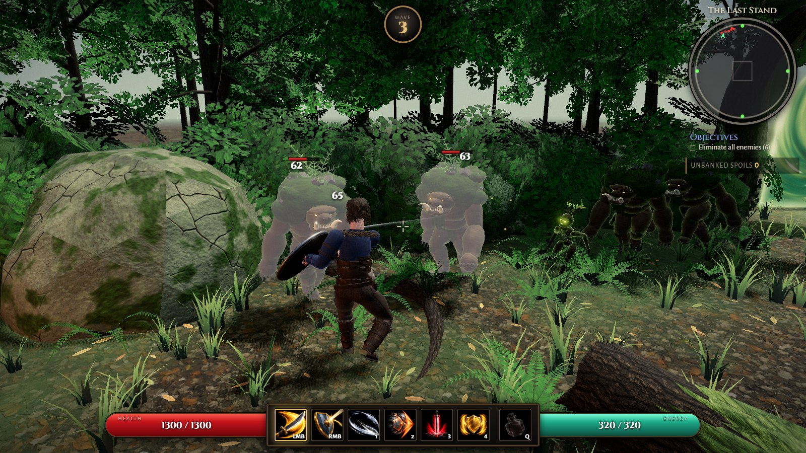

| The Crypt, from above | Wave cleared: bank or continue? |
| --- | --- |
| 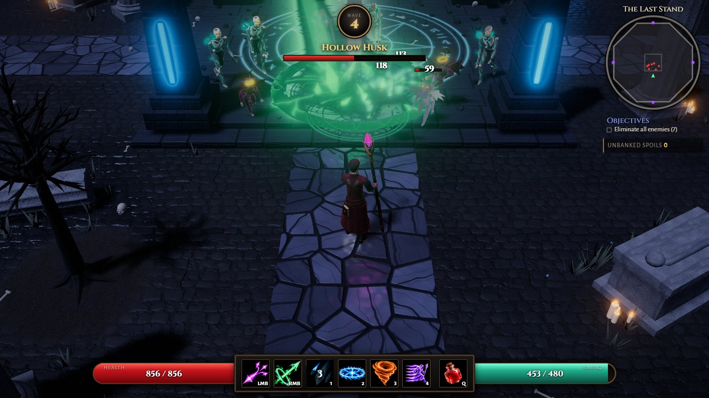 | 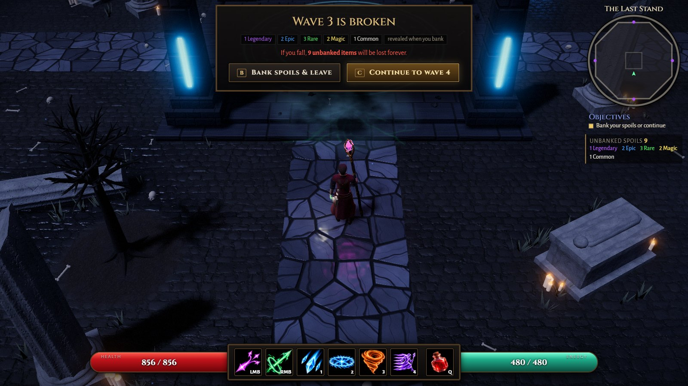 |

| A party of four | A partner down: hold **E** to raise them |
| --- | --- |
| 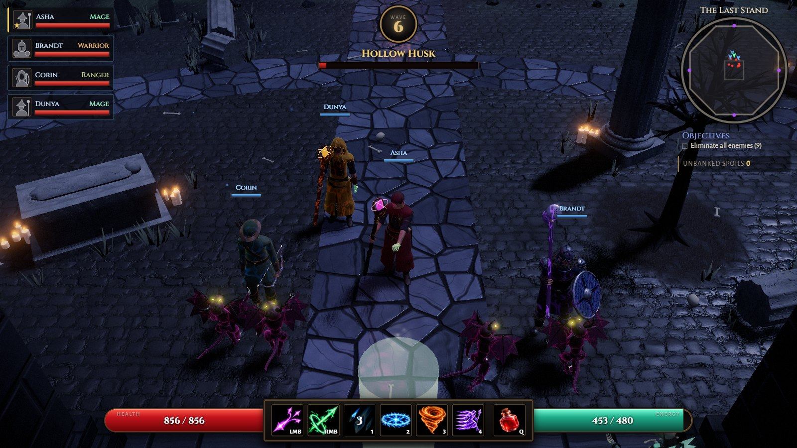 | 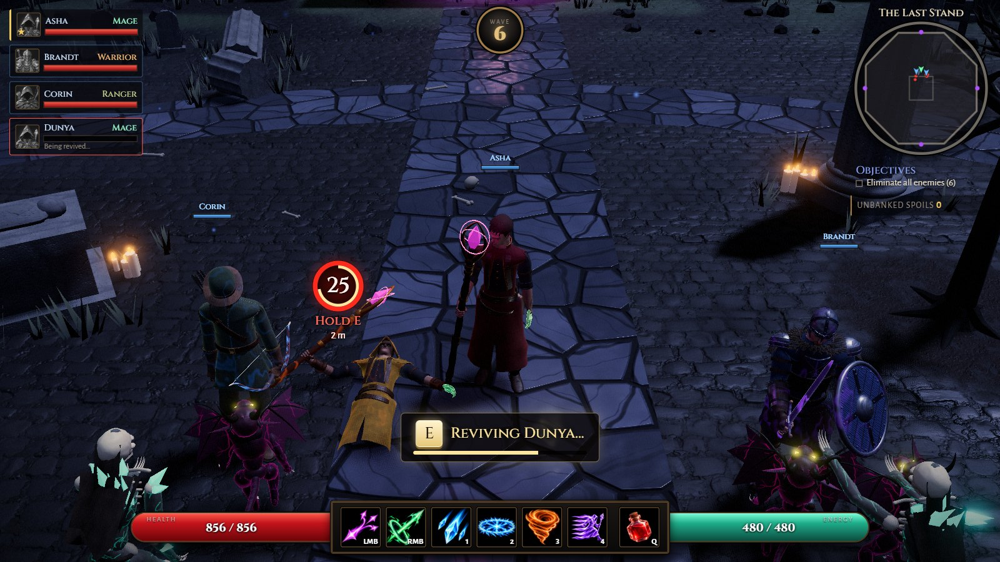 |

Nearly everything is made by code as the game runs: the models, their animation, the effects, the sound effects and most textures. What isn't: the painted skill icons (`src/ui/skillArt/`), the optional party portraits (`src/ui/portraits/`), the music (`src/audio/music/`) and a few small CC0 photos (ground, bark) the maps take their colours from (`src/core/photos/`). There are no downloaded 3D models.

## How to play

- Pick a hero: the **Mage**, the **Warrior** or the **Ranger**. Each keeps their own gear, stash and records.
- Pick a battleground, the **Crypt** or the **Thornwood** (or the dice for a random one each run). Each has its own enemies.
- Start a run at any wave up to the best one you cleared **and banked** in that battleground; a run you died in doesn't count. On Random, the range is the waves banked in any battleground, and the dice roll among those the wave you pick is unlocked in.
- Survive each wave inside the arena. Every fifth wave, a boss arrives: the **Hollow Colossus** in the Crypt, the **Elder Thornheart** in the Thornwood.
- After every wave, choose:
  - **Bank** — leave the arena and move everything you found into your stash, or
  - **Continue** — face a harder wave with better loot (you recover 25% health).
- Loot goes straight into your bag, **unseen**: you only know how many items of each rarity you carry (1 Legendary, 2 Epic...). Banking reveals what they are, the best first.
- Below half health the screen drains of colour and blood seeps in from its edges, more the closer you are to none.
- If you die, **all unbanked spoils are lost**, never seen.
- Equip what you find between runs. Items roll random affixes across six rarities, Common to **Ascendant**, and gear from Rare up glows in its rarity's colour on your hero.

| The hall of heroes | The stash |
| --- | --- |
| 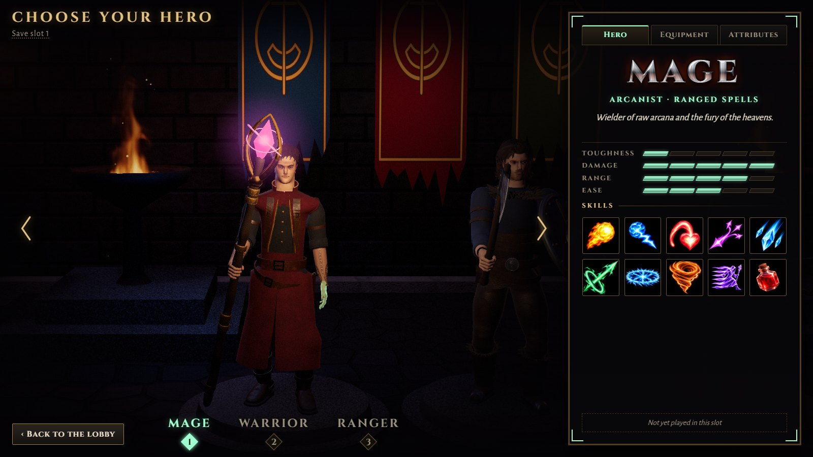 | 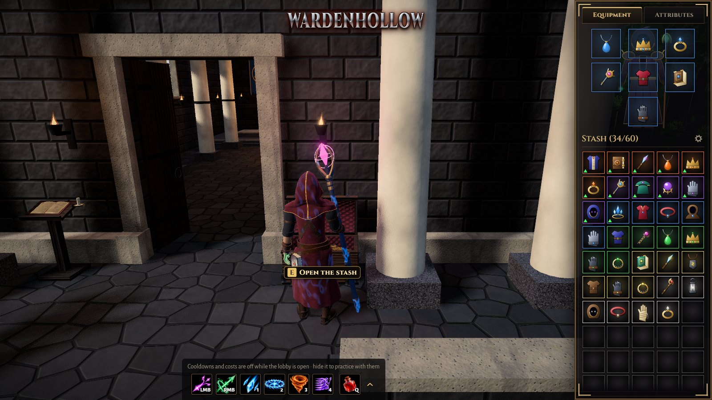 |

### The lobby

Between runs you are in the lobby: your hero on the battleground with panels round them for the equipment, the stash, the attributes and the skills. Walk around and try every skill for free on the training dummies, and fold the panels away by the tabs on their edges to make room.

**Training grounds** (the lobby's button): pick a battleground and any wave that hero has reached there, including waves lost. The enemies are projections: skills cost and cool down as in a run, but you take no damage and earn no loot, score or progress. After a wave, repeat it or leave.

### Beta: the village lobby

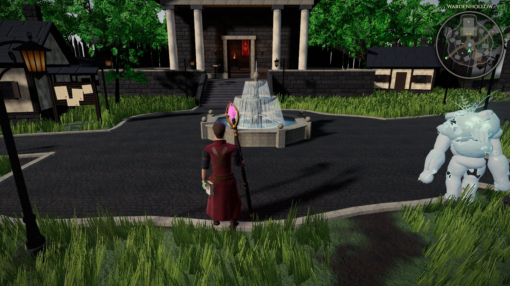

A new lobby to try: Wardenhollow, a village you walk around, in place of the panels. Switch it on in the pause menu (**Esc**), under **Beta**, and press **Reload**; the game remembers the choice, and a notice as it opens (or the same tab) takes you back to the old lobby. Your heroes and saves are the same either way.

- Walk up to something and press **E** (or click it, or tap it) to use it: the portals to the **Crypt** and the **Thornwood**, the chest for your stash, the hall of heroes to change hero, the campfire to play together, the chronicle for save slots, the notice board for how to play, the ghost by the training yard for the training grounds.
- **I** opens the inventory (equipment, attributes, skills) anywhere and **M** the village's map. On touch, **Use**, **Bag** and **Map** stand beside the minimap, and a camera button changes the view.
- Skills work in the training yard, on its dummies: free while the inventory is open, with a run's costs and cooldowns once it's put away. A first visit starts with a short training round the village, which you can skip.
- The village keeps your clock's hours: day and night, with lamps lit after dusk.
- In co-op a room is in its host's lobby: joining one in the other lobby offers to switch and join.

### Play together

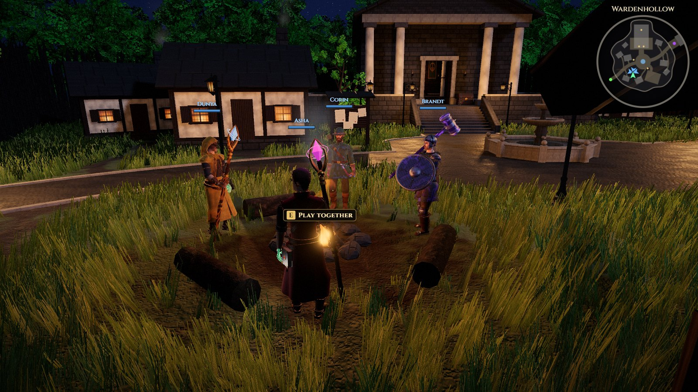

Up to four players can hold the arena together over the internet, each under a name tag of their own (asked for once, and unique in a room) and in a colour of their own. In the lobby, **Play together** (the campfire, in the village) → **Open a room** gives a short code and an invite link to send friends; opening the link (or entering the code) joins the room. The games talk through a small relay server of ours (`server/relay`), over a WebSocket that gets through any network a web page does.

- Each player brings their own hero, gear and loadout, and keeps their own spoils: loot goes to whoever lands the kill (a boss pays everyone), and each bag stays hidden until its owner banks.
- The host picks the battleground and starting wave and starts the run. A party faces more foes, each with more life.
- After every wave everyone chooses: **Bank** leaves the run with your spoils right away; the next wave starts once everyone staying chose **Continue**. Players who left watch the rest of the run: **left click** follows the next player, **right click** the one before, **Q** / **E** (or a middle drag) turn the camera, and **F** flies a free camera with `W A S D`; on touch the bar at the top has a button for each, and two fingers twisted turn the camera. Once nobody is left in the run, everyone goes back to the lobby together.
- At 0 health you go **down** rather than die. A teammate can raise you by standing next to you and holding **E** (the **Revive** button on touch) for a little over 2 seconds. If you're not raised within 25 seconds, or you're still down when the wave ends, you fall and lose your spoils. With nobody left standing, the run is lost for everyone still in it.
- **Left Shift** pings a foe or a spot for the party, and **Enter** opens the chat.
- The party list in the top left shows your card first, then your partners': name, class, health and status, a gold star on the host. In **Play together**, **Your portrait (optional)** picks a painted portrait for your card.
- The game can't pause for one player: the pause menu only stops your hero. If the host leaves mid-run, the others keep what they found, as if banked.

### Saves

There are **three save slots** (the lobby's *Save slot* link; the chronicle, in the village), each a separate save with its own heroes, skill loadouts and stash filters. The save slots screen shows what each one holds, and from there you play a slot or delete one (typing DELETE to confirm). An empty slot is a fresh start, for instance to play from the beginning with a friend.

**Cloud saves** (optional): sign in on the save slots screen with a passkey, with Google, or with a sign-in code from a device already signed in, choose which save goes to the cloud, and it keeps the same heroes on every device you sign in on. It keeps playing offline and syncs when back online; a hero played on two devices while out of sync asks which copy to keep. No account is needed to play. What is kept, and how to delete it: [privacy](public/privacy.html).

### Report a bug

**Report a bug**, at the foot of the pause menu (`Esc`), opens a short form: pick what it's about (gameplay, looks, speed, sound, controls, playing together, menus, saves, a crash, an idea), say what happened, and a picture of the game as it was goes along unless you untick it. The game adds where you were, its version and your device's make, never your name tag, a room's code or your saves, and shows you the whole report first. Nothing leaves your device until you press **Send**, which sends it, the picture with it, to the game's own server (the one the performance reports go to), and gives you the report's code; a send that fails keeps the report to try again. **Copy report** puts the text on your clipboard instead, for when you're offline.

### Install and play offline

Last Stand is an installable web app. Use the **Install** link in the lobby (Chrome, Edge, Android), or *Add to Home Screen* on iOS. Once it has loaded, it also plays without a connection. A new version downloads in the background, and the lobby offers a reload when it's ready.

## Controls

Plays with a keyboard and mouse, or by touch on phones and tablets (hold a phone sideways). Each hero's skills and their keys are under [Classes](#classes).

| Input | Action |
| --- | --- |
| `W A S D` | Move |
| Mouse | Aim |
| Left click, right click, `1`–`4`, `Q` | Skills |
| Mouse wheel | Zoom |
| Middle mouse (hold and drag) | Rotate the camera |
| `V` | Change view: top-down, over the shoulder, first person. The close views use mouse look and aim at the crosshair |
| `Alt` (hold) | In the close views: a cursor for the HUD, the view held still |
| `B` / `C` | Bank / Continue after a wave |
| `E` | Use what you stand by in the village; hold to revive a downed partner (co-op) |
| `I` / `M` | The village: inventory / map |
| `Left Shift` (hold, let go) | Ping the party (co-op) |
| `Enter` | Chat with the party (co-op) |
| `Esc` | Pause: controls, settings, performance, beta |

On touch:

- **Move:** a stick anywhere on the left half of the screen.
- **Skills:** the buttons on the right. Tap to cast at the nearest foe, or drag to aim and let go to cast there; hold the attack button or a channelled skill to keep it going.
- **Other:** pinch to zoom, twist two fingers to turn the camera, and the ❚❚ button pauses.
- **Lobby:** tap items to equip them or drop them on the floor, and tap a key, then a skill, to rebind it.

Skills can be **rebound**: in the lobby the chevron beside the key bar (or a click on a key) opens the spellbook above it. Click a key, then a skill, or drag a skill onto any key; drag keys onto each other to swap. Each class, and each way of holding weapons, remembers its own keys.

## Classes

Every class keeps its **own profile**: equipment, stash, records and the starting waves unlocked in each battleground. Loot found by one class is made for it and stays with it. The diagrams show each class's default keys.

### The Mage

Robes and a crystal staff; arcane and elemental spells from range. A staff is attuned to a school (arcane, fire, lightning or healing), shown by its crystal's colour, and the school sets the spell on left click. With no staff, Void Lance is cast from either hand, or from both with two of its keys held, harder and at a higher cost in Energy.

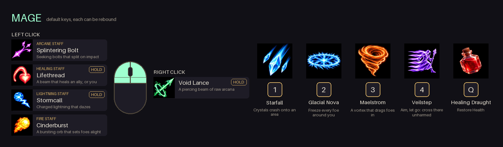

### The Warrior

Plate armour; tougher, and fights up close: with a one-handed weapon and a shield, a weapon in each hand, or a two-handed weapon, and right click follows what is held. Shields **block**: each hit has the shield's Block Chance to be blocked, and holding right click raises the shield to block every hit from the front; a hit too big for it breaks the guard and staggers you. With a two-hander, Thunder Crescent can be bound to a key too.

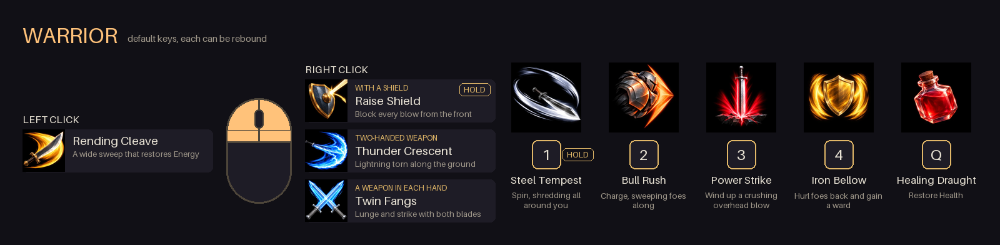

### The Ranger

A bow hunter in a trailcoat with a quiver; lighter armour, speed and physical damage from range. Shots are drawn by holding and loosed by letting go: the further drawn, the harder they hit.

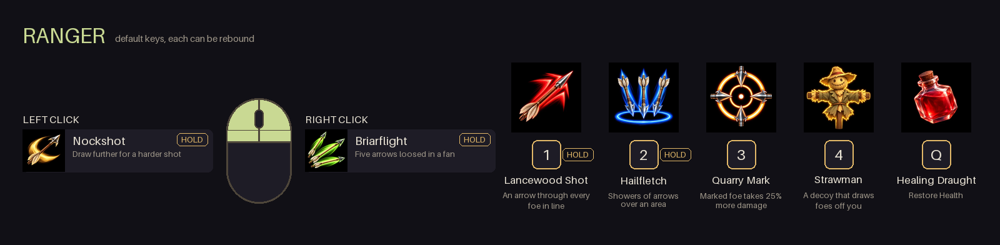

## Tech

- [Three.js](https://threejs.org/) 0.187 with an HDR post-processing chain (bloom, tone mapping, grading); WebGL by default, with a WebGPU renderer to try from the pause menu
- TypeScript (strict) + [Vite](https://vite.dev/)
- Procedural models, humanoid rigs and animation, CPU particles, pooled dynamic lights, and procedural textures (a few take their colours from CC0 photos)
- The Thornwood's trees are grown by [ez-tree](https://github.com/dgreenheck/ez-tree) (MIT), its geometry with our own procedural bark and leaves
- The fires' flames are a fluid simulated once and played back, after the physics of [Fire Pro](https://github.com/dgreenheck/threejs-fire-pro) (MIT)
- WebAudio-synthesized sound effects, and music for each battleground: one track in its lobby and between waves, one through each wave's fight
- Co-op through our own WebSocket relay server (`server/relay`, Node and [ws](https://github.com/websockets/ws)); optional cloud saves with passkeys (`server/saves`)
- An installable, offline-capable web app

## Development

```bash
npm install
npm run dev        # http://localhost:5173
npm run typecheck
npm run build      # type-check + production build into dist/
```

The README's pictures are retaken with `npm run lab -- readme` and the key diagrams with `npm run icons -- keys` (`docs/screenshots/AGENTS.md`).

### Project layout

| Path | Contents |
| --- | --- |
| `src/data/` | Tuning data: classes & skills, enemies, biomes, items, waves, balance |
| `src/combat/skills/` | Skill behaviors, referenced by name from class data |
| `src/entities/` | Player, enemies, enemy AI, procedural models (`models/`) |
| `src/game/` | Wave flow, scoring, loot rolls, bank / continue (`run.ts`); the village and the hall of heroes |
| `src/world/` | The battlegrounds (`crypt.ts`, `forest.ts`), the village, shared props, collision |
| `src/fx/` | Particles, effects, pooled lights |
| `src/loot/` | Items, persistent profiles (one per class and save slot: stash / equipment / records), save slots, skill loadout |
| `src/net/` | Co-op: rooms and links between the games, the players' state, the host's reports of the fight |
| `src/ui/` | HUD, menus, tooltips, loadout editor, skill icons |
| `server/` | The co-op relay, cloud saves, performance traces, PR previews |
| `tools/` | The harnesses the game is judged by (`tools/lab`) and the asset tools |

**Adding a class:** create a data file in `src/data/classes/`, register it in `src/data/classes/index.ts`, add a model in `src/entities/models/`, and implement any new skills in `src/combat/skills/`.

## Feedback

This is an early build — feedback, bug reports and ideas are very welcome in [Issues](https://github.com/VictorZakharov/last-stand/issues). To contribute code, see [CONTRIBUTE.md](CONTRIBUTE.md).

## License

[MIT](LICENSE).
